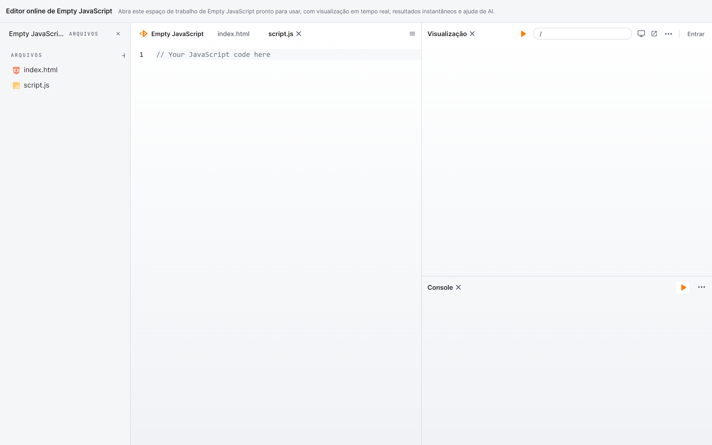
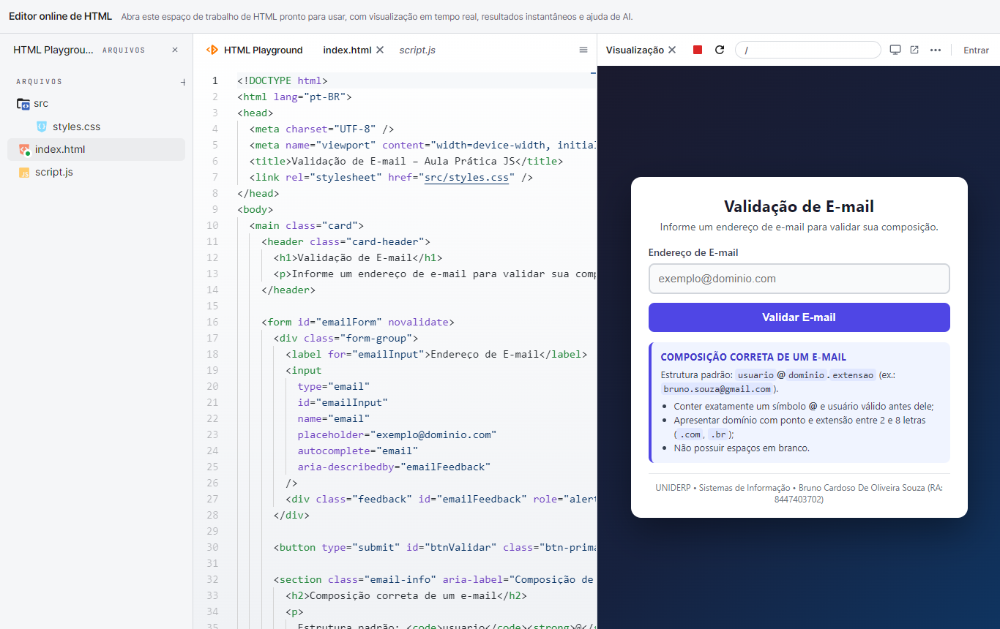
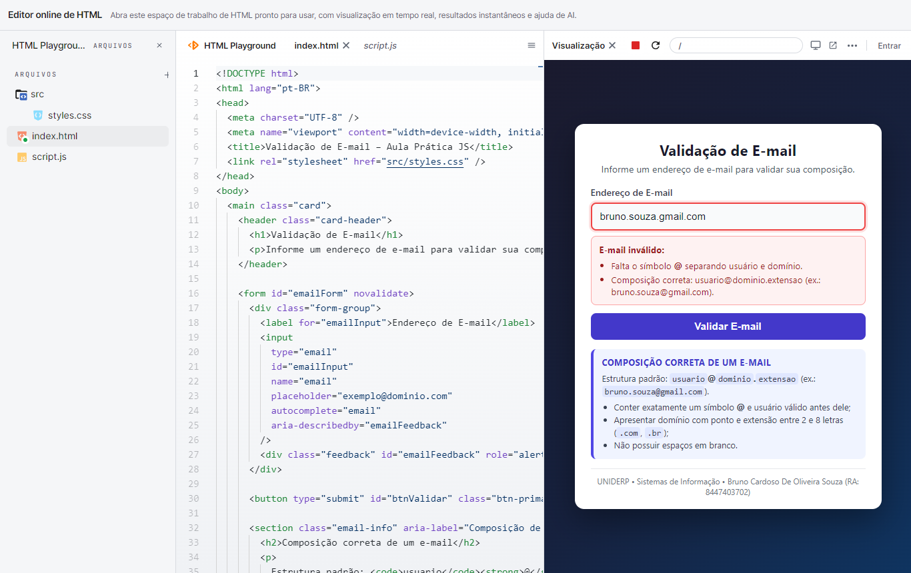
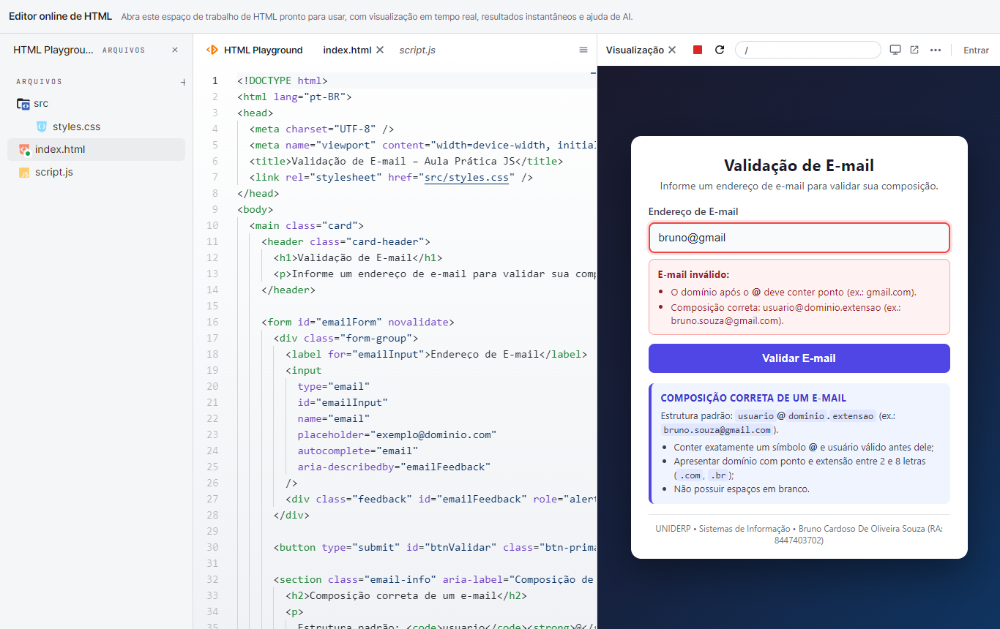
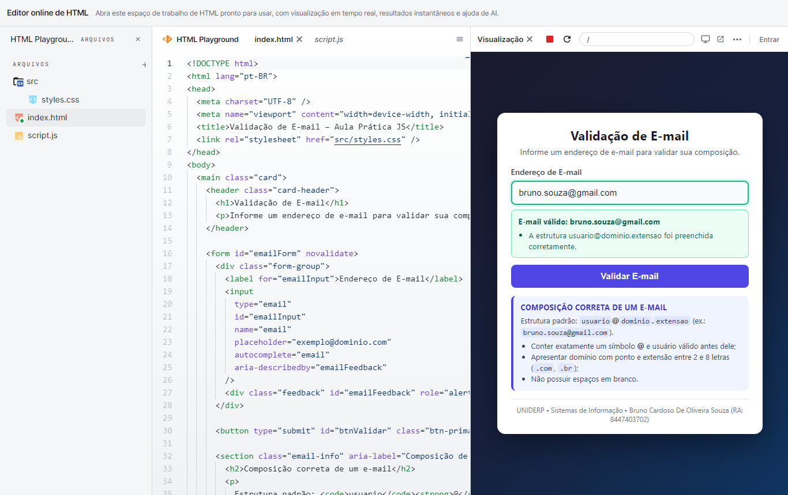

# Validação de Campo de E-mail em JavaScript (Playcode.io)

Projeto desenvolvido para a aula prática da disciplina **Desenvolvimento em JavaScript**, seguindo o roteiro institucional da **UNIDERP – Universidade Anhanguera**.

- **Instituição:** UNIDERP – Universidade Anhanguera
- **Curso:** Sistemas de Informação
- **Disciplina:** Desenvolvimento em JavaScript
- **Professor:** Renan Cleverson Laureano Flor da Rosa
- **Aluno:** Bruno Cardoso De Oliveira Souza (`RA: 8447403702`)
- **Cidade/UF:** Uberlândia – MG

---

## Objetivo da Atividade

Construir uma aplicação web simples em HTML5, CSS3 e JavaScript puro, validando o preenchimento de um campo de e-mail na plataforma **Playcode.io**, exibindo alertas visuais e orientando o usuário quanto à composição correta de um endereço eletrônico (`usuario@dominio.extensao`).

---

## Estrutura do Repositório

```text
.
├── index.html                                           # Formulário HTML semântico com bloco orientativo
├── style.css                                            # Estilização responsiva e feedback visual
├── script.js                                            # Lógica de validação (Regex + regras específicas + DOM)
├── tests/
│   └── email.test.js                                    # Suíte com 34 testes automatizados (Node.js)
├── evidencias/
│   ├── 01_criacao_projeto_playcode.png                  # Projeto vazio criado no Playcode.io
│   ├── 02_codigo_html_playcode.png                      # Código HTML no editor do Playcode.io
│   ├── 03_codigo_js_playcode.png                        # Código JavaScript (Regex e analisarEmail)
│   ├── 03b_codigo_js_eventos_playcode.png               # Código JavaScript (validateEmail e eventos DOM)
│   ├── 04_execucao_inicial_playcode.png                 # Formulário em execução inicial
│   ├── 05_teste_campo_vazio_playcode.png                # Teste de campo obrigatório vazio
│   ├── 06_teste_email_invalido_sem_arroba_playcode.png  # Teste sem símbolo '@'
│   ├── 07_teste_email_invalido_dominio_playcode.png     # Teste com domínio incompleto
│   ├── 08_teste_email_valido_playcode.png               # Teste com e-mail válido aprovado
│   └── 09_testes_automatizados_node.png                 # Execução da suíte automatizada no terminal
├── Relatorio_Aula_Pratica_JavaScript_Bruno_Cardoso.docx # Relatório acadêmico (UNIDERP + ABNT)
├── Relatorio_Aula_Pratica_JavaScript_Bruno_Cardoso.pdf  # Relatório exportado em PDF
└── README.md
```

---

## Como Executar

### 1. No navegador ou Playcode.io

Abra [`index.html`](index.html) diretamente no navegador (ou importe `index.html`, `style.css` e `script.js` no [Playcode.io](https://playcode.io)).

### 2. Testes automatizados (Node.js)

O arquivo [`tests/email.test.js`](tests/email.test.js) importa diretamente `EMAIL_REGEX`, `analisarEmail` e `escapeHTML` de [`script.js`](script.js) e executa 34 casos de teste sem dependências externas:

```bash
node tests/email.test.js
```

Saída esperada: `RESULTADO FINAL: 34/34 testes passaram`.

---

## Evidências na Plataforma Playcode.io

| Criação do Projeto Vazio | Código HTML & Preview |
| --- | --- |
|  |  |

| Teste: Campo Vazio | Teste: Sem `@` (`bruno.souza.gmail.com`) |
| --- | --- |
|  |  |

| Teste: Domínio Incompleto (`bruno@gmail`) | Teste: E-mail Válido (`bruno.souza@gmail.com`) |
| --- | --- |
|  |  |

---

## Relatório Acadêmico (Padrão UNIDERP + ABNT)

- Versão editável (com sumário automático): [`Relatorio_Aula_Pratica_JavaScript_Bruno_Cardoso.docx`](Relatorio_Aula_Pratica_JavaScript_Bruno_Cardoso.docx)
- Versão final para entrega: [`Relatorio_Aula_Pratica_JavaScript_Bruno_Cardoso.pdf`](Relatorio_Aula_Pratica_JavaScript_Bruno_Cardoso.pdf)
